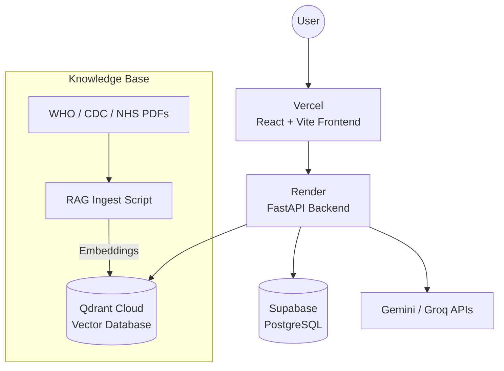

<div align="center">
  
  <h1>ISCOR AI 🧠</h1>
  <p><strong>Intelligent Screening & Contextual Outcome Recommender</strong></p>
  <p>
    <a href="https://iscor-ai.vercel.app"><strong>View Live Demo »</strong></a>
  </p>
</div>

<hr />

## 📖 Overview

**ISCOR AI** is a safety-oriented AI-based student mental wellness screening and wellness companion. It combines **Machine Learning, Explainable AI (XAI), Retrieval-Augmented Generation (RAG), and Large Language Models (LLMs)** to provide personalized, evidence-grounded wellness guidance.

The system analyzes structured lifestyle and stress-related information to classify a student's wellness risk (Low, Moderate, High), explains the prediction using **SHAP**, retrieves supporting information from curated wellness resources (WHO, CDC, NHS) using a **Qdrant Vector DB**, and uses an LLM to communicate the results through highly personalized wellness plans and conversational support.

> ⚠️ **Important:** ISCOR AI is a screening, self-reflection, and wellness-support system. It is **not a medical diagnostic system**, does not prescribe medication, and does not replace professional psychiatric or psychological care.

---

## ✨ Features

- **📊 Predictive Screening**: Machine learning (Random Forest) classification of wellness and stress risks based on lifestyle data.
- **🔍 Explainable AI (SHAP)**: Complete transparency into *why* the model made its prediction, translating complex feature importance metrics into human-readable insights.
- **📚 Retrieval-Augmented Generation (RAG)**: Automatically grounds LLM responses in curated mental health documentation (WHO, CDC, NHS, University guidelines) via Qdrant Cloud.
- **💬 Generative Wellness Companion**: Context-aware chat support powered by Gemini / Groq that understands a user's historical trends.
- **🛡️ Dynamic Risk Routing**: High-risk or crisis inputs trigger immediate safety protocols, bypassing LLM generation in favor of static, vetted crisis resources.
- **🔒 Cryptographic Privacy**: Local AES encryption (Fernet) ensures sensitive user data is heavily encrypted before hitting the database.
- **📈 Historical Tracking**: Interactive dashboards visualizing long-term wellness trends and shifting SHAP factors.

---

## 🏗️ Cloud-Native Architecture

This project is built on a decoupled, highly scalable cloud-native architecture.

<div align="center">



</div>

### Technology Stack
- **Frontend**: React.js, Vite, Tailwind CSS (Hosted on Vercel)
- **Backend**: Python, FastAPI, Uvicorn, Docker (Hosted on Render)
- **Database**: PostgreSQL with Connection Pooling (Hosted on Supabase)
- **Vector Store**: Qdrant Cloud (formerly local ChromaDB)
- **Machine Learning**: Scikit-Learn, SHAP, Sentence-Transformers (`all-MiniLM-L6-v2`)
- **LLM Integrations**: Google Gemini API, Groq (Llama)

---

## 📊 Evaluation

The deployed classifier is a Random Forest. Results on the held-out primary test split (1,405 samples):

| Class | Precision | Recall | F1 | Support |
|---|---|---|---|---|
| Low | 0.31 | 0.22 | 0.26 | 204 |
| Moderate | 0.46 | 0.42 | 0.44 | 346 |
| High | 0.69 | 0.76 | 0.72 | 855 |

Accuracy 0.60, macro-F1 0.47, macro ROC-AUC 0.76, high-risk Brier score 0.20.

- **Strength:** the High class is the safety-critical one, and it has the best recall (0.76).
- **Weakness:** Low-risk students are often misclassified (recall 0.22). The classes are imbalanced and the signal is limited, so treat this as a screening aid only.
- **Fairness:** across gender on high-risk classification, the disparate impact ratio is 0.997 and the equal opportunity difference is 0.027.
- **Generalization:** on an external depression dataset with a bridged binary label, accuracy is 0.61, against a 0.50 majority-class baseline. This is a modest result.

Full details are in [docs/metrics_report.md](docs/metrics_report.md).

---

## 🚀 Live Demo

You can interact with the live production deployment of ISCOR AI here:
👉 **[https://iscor-ai.vercel.app](https://iscor-ai.vercel.app/)**

### Test Scenarios to Try
1. **Low Risk**: High sleep hours, low academic pressure, good social support.
2. **Moderate Risk**: Poor sleep, moderate stress, missing physical activity. (Notice how the LLM generates a custom weekly plan).
3. **High/Crisis Risk**: Type words like "hopeless" or "harm" into the companion, or submit extremely high stress factors. (Notice how the Risk Gate activates and provides crisis hotlines immediately).

---

## 💻 Local Development Setup

If you wish to run ISCOR AI locally or deploy your own instance, follow these steps:

### 1. Prerequisites
- Python 3.10+
- Node.js 18+
- [Supabase](https://supabase.com/) account
- [Qdrant Cloud](https://cloud.qdrant.io/) account
- Google Gemini API Key

### 2. Clone the Repository
```bash
git clone https://github.com/deonbinny7/ISCOR-AI.git
cd ISCOR-AI
```

### 3. Backend Setup
```bash
# Create a virtual environment
python -m venv .venv
source .venv/bin/activate  # On Windows use: .venv\Scripts\activate

# Install dependencies
pip install -r requirements.txt

# Create your .env file
cp .env.example .env
```

**Configure your `.env` variables:**
- `DATABASE_URL`: Your Supabase **Transaction Connection Pooler URL** (IPv4).
- `QDRANT_URL` & `QDRANT_API_KEY`: From your Qdrant Cloud dashboard.
- `GEMINI_API_KEY_1`: Your Gemini key.
- `ISCOR_DB_ENCRYPTION_KEY`: Generate a secure Fernet key.

**Ingest the Knowledge Base:**
Upload the PDFs into Qdrant to power the RAG engine:
```bash
python scripts/rag_ingest.py
```

**Start the Server:**
```bash
uvicorn integration.api:app --reload
```

### 4. Frontend Setup
Open a new terminal window:
```bash
cd frontend
npm install

# Create a frontend .env file
echo "VITE_API_URL=http://127.0.0.1:8000" > .env

# Start the dev server
npm run dev
```

---

## 🔒 Security & Privacy Notes

1. **Anonymous Sessions**: Users are not required to provide identifiable information (name, email) to use the screening tool. Sessions are tracked via SHA-256 hashed browser tokens.
2. **Database Encryption**: All sensitive assessment data (inputs, generated plans) are encrypted at rest using AES (Fernet) before being saved to PostgreSQL.
3. **CORS Restrictions**: The production backend is tightly restricted to only accept API requests from the verified Vercel frontend domain.

---

## 🤝 Contributing

Contributions, issues, and feature requests are welcome! Feel free to check the [issues page](https://github.com/deonbinny7/ISCOR-AI/issues).

## 📄 License

This project is developed as an academic implementation and is licensed under the MIT License.
